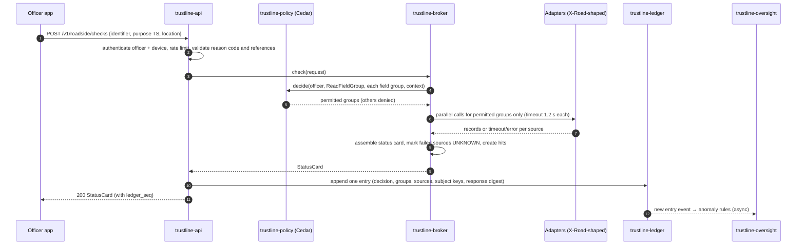
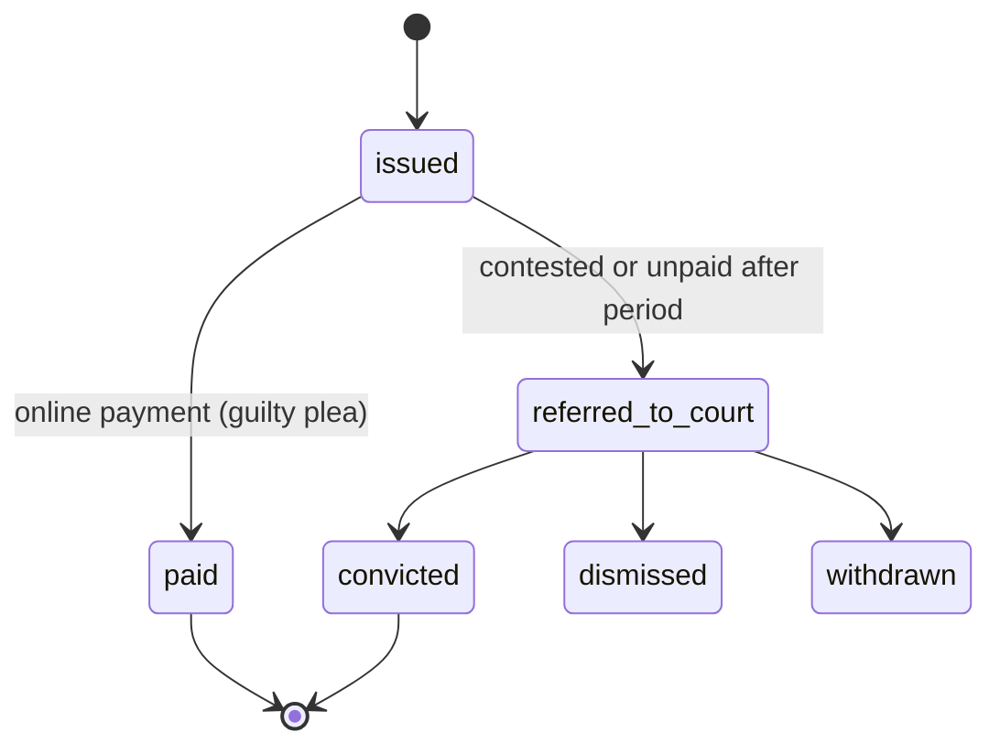
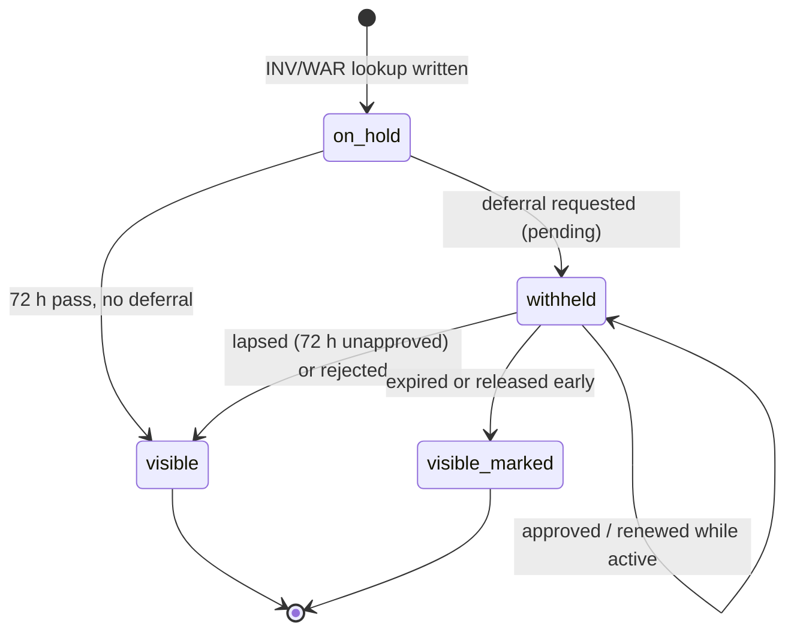

# 02 — Architecture

TRUSTLINE is one Rust API service built from library crates, a PostgreSQL database that holds
only TRUSTLINE-owned records, adapters that fetch agency data at query time, and a Next.js web
app. In this build every agency is played by `services/mock-agencies` with synthetic data.

## 1. Request lifecycle (roadside check)

Order matters: **policy before fetch**. The broker never calls an adapter for a field group the
policy did not permit, so data the officer may not see is never retrieved. Tests assert the mock
received no other call.

## 2. Components

| Crate / app | Responsibility | Must not |
| --- | --- | --- |
| `trustline-core` | Identifier parsing and normalisation; `SubjectKey`; `Purpose`, `Role`, `FieldGroup`; status-card types; config; `Problem` errors | Do I/O |
| `trustline-policy` | Load, validate and evaluate Cedar; `policy_version` = SHA-256 of policy text + schema | Contain hard-coded permissions |
| `trustline-ledger` | RFC 8785 canonical JSON; SHA-256 chain; Ed25519 signatures; checkpoints; `verify` | Expose update or delete |
| `trustline-adapters` | `AgencyAdapter` trait; one adapter per agency; X-Road-shaped headers; timeouts; response validation | Cache personal records |
| `trustline-broker` | Resolve identifiers; ask policy; fan out permitted calls; assemble cards and investigation results; hits | Fetch then filter |
| `trustline-tickets` | Issue, pay, refer, outcome; section 107 detection; court timeline | Decide licence actions |
| `trustline-demerit` | Pure section 179 engine: history + schedule → points, thresholds, proposed actions | Do I/O or take effect |
| `trustline-oversight` | Anomaly rules over ledger entries; alerts; monthly report | Read record content |
| `trustline-offline` | Build, sign, encrypt, verify bundles; UniFFI-ready | Depend on an async runtime |
| `trustline-api` | axum routes per `api/openapi.yaml`; authn; rate limits; ledger middleware | Hold business rules beyond wiring |
| `trustline-cli` | `seed`, `keys`, `ledger verify`, `report monthly` | Run in production with DEV_AUTH |
| `services/mock-agencies` | Synthetic agency APIs with latency and failure injection | Contain real data |
| `apps/web` | Role screens; calls the API only | Hold rules or personal data in storage |

## 3. Identifiers and subject keys

- Raw identifiers (NIC, licence number, plate) arrive in the request body and are passed to
  adapters. They are never written to the ledger, application logs or traces.
- `SubjectKey = HMAC-SHA-256(pepper, "<TYPE>:" + normalised_value)`, base64url, where TYPE is
  `NIC`, `DL` or `PLATE`. Normalisation: uppercase, strip spaces and hyphens.
- Every ledger entry is attributed to the **person's NIC key**: licence lookups resolve to the
  holder's NIC; plate lookups record the plate key as `primary` and each registered owner's NIC
  key as `vehicle_owner`. Deferral and designation handling attaches the subject with relation
  `administrative`, which no citizen log ever shows. The citizen access log is read only through
  `citizen.visible_access_events` (§13).
- The pepper lives in the key store (`.local/` in development; HSM in the pilot) and rotates with
  a version prefix (`k1:`); old keys are kept for lookup.
- Tickets are legal records: their identifiers are stored envelope-encrypted
  (`*_enc` columns; data key per row, wrapped by a key-encryption key from the key store).

## 4. Field groups and adapters

Field groups (the unit of permission) are defined in `rules/field-groups.yaml` with their
domain and the adapter calls they need. Permissions per role and purpose are in
`docs/05-access-policy.md` and `policies/trustline.cedar`.

### Adapter contract (X-Road-shaped)

Every adapter call is HTTPS JSON with these headers, mirroring the X-Road REST protocol so that
the pilot can swap the transport for an X-Road Security Server without touching the broker:

| Header | Example | Meaning |
| --- | --- | --- |
| `X-Road-Client` | `SLU/GOV/TRUSTLINE/roadside` | Calling subsystem |
| `X-Road-Service` | `SLU/GOV/TRANSPORT/licensing/getDriverByNic/v1` | Target service |
| `X-Road-Id` | UUID v7 | Message id, also stored in the ledger entry's source list |
| `X-Road-UserId` | `SLU/RSLPF/OFF-101` | The human on whose behalf the call is made |
| `X-Road-Issue` | `TS` or `INV;CASE-2026-00412` | Purpose code and reference |

Timeouts: 1.2 s per call for roadside checks, 5 s for investigation and crash queries.
A failed or slow source yields `UNKNOWN` fields with `sources[].status = timeout | error`.

### Mock agency endpoints (`services/mock-agencies`, port 8090)

| Agency | Endpoint | Returns |
| --- | --- | --- |
| Licensing (Division of Transport) | `GET /licensing/v1/drivers/by-nic/{nic}` · `GET /licensing/v1/drivers/by-licence/{licenceNo}` | Driver: licence number, name, date of birth, photo ref, classes, status, issue and expiry dates, endorsements |
| Licensing | `GET /licensing/v1/vehicles/by-plate/{plate}` · `GET /licensing/v1/vehicles/by-owner/{nic}` | Vehicle: plate, make, model, colour, year, registration status and expiry, owner NICs |
| Police (RSLPF) | `GET /police/v1/flags/person/{nic}` · `GET /police/v1/flags/vehicle/{plate}` · `GET /police/v1/flags/{flagRef}` | Warrant or stolen flag with reference, status and contact |
| Police | `GET /police/v1/criminal-record/{nic}` (requires `X-Road-Issue` with a case ref) · `GET /police/v1/accidents/person/{nic}` · `GET /police/v1/accidents/vehicle/{plate}` | Records for case- or incident-gated queries |
| Police (reference checks) | `GET /police/v1/cases/{caseRef}` · `GET /police/v1/warrants/{warrantRef}` · `GET /police/v1/incidents/{incidentRef}` | Open/active status and unit; used to set `case_ref_valid`, `warrant_ref_valid`, `incident_active` before policy |
| Courts (Magistracy, Traffic Part) | `POST /courts/v1/traffic/referrals` · `GET /courts/v1/traffic/cases/{caseRef}` · `GET /courts/v1/traffic/person/{nic}/pending` | Case reference; hearings, status, outcome; pending flag and next date |
| Insurance (insurers' feed) | `GET /insurance/v1/policies/by-plate/{plate}` | Status, insurer, masked policy number, expiry |
| Inspection (approved garages) | `GET /inspection/v1/by-plate/{plate}` · `GET /inspection/v1/history/{plate}` | Status, last inspection, expiry, garage; history |
| Health (Ministry of Health) | `GET /health/v1/emergency-card/{nic}` (requires `X-Road-Issue: EMS;<incidentRef>`) | Blood group, allergies, critical conditions, emergency contact — only for opted-in persons |
| NAF (mock OIDC) | `/naf/.well-known/openid-configuration`, `/naf/authorize`, `/naf/token`, `/naf/jwks` | Authorization code + PKCE; `sub` = synthetic NIC |

The mock reads fixtures generated by `trustline-cli seed` and supports per-agency latency
(`MOCK_LATENCY_MS_<AGENCY>`) and failure injection (`MOCK_FAIL_RATE_<AGENCY>`, `MOCK_DOWN=<agency>`).

## 5. Status card assembly

1. Parse and normalise the identifier; compute its key.
2. Resolve the person: NIC directly; licence → holder NIC (licensing adapter); plate → vehicle and
   owner NICs (licensing adapter). Resolution calls are part of the `identity_basic` or
   `vehicle_registration` group and are made only if that group is permitted.
3. Ask policy for each field group relevant to the request kind (`rules/field-groups.yaml` →
   `request_kinds`).
4. Call the adapters for permitted groups in parallel.
5. Assemble the card; derive `points_band` from the demerit ledger (TRUSTLINE-owned) and
   `compliance_summary` from tickets (TRUSTLINE-owned); apply effective licence actions
   (a confirmed suspension overrides the licensing source's status).
6. Create `core.hit` rows for any warrant or stolen flag and show `UNCONFIRMED_MATCH`.
7. Return the card with `ledger_seq` and `sources`.

## 6. Ledger

- Table `ledger.access_event` (append-only; the application role has INSERT and SELECT only, and a
  trigger rejects UPDATE and DELETE even for the table owner).
- Entry body (canonicalised with RFC 8785 before hashing): `seq`, `event_id`, `occurred_at`,
  `actor` (type, id, badge, roles, agency, unit), `device_id`, `purpose`, `case_ref`,
  `incident_ref`, `warrant_ref`, `request_kind`, `identifier_type`, `subject_keys` (with relation),
  `decision` (allow | partial | deny | error | rate_limited), `permitted_groups`, `denied_groups`,
  `policy_version`, `rules_version`, `sources` (agency, X-Road-Id, status), `response_digest`
  (SHA-256 of the response body — never the body), `offline`, `http_status`.
- `entry_hash = SHA-256(prev_hash || canonical_body)`; `signature = Ed25519(entry_hash)` with `key_id`.
  The first entry's `prev_hash` is 32 zero bytes.
- Writes are serialised through one advisory lock so the chain has no forks; target throughput
  well above pilot volume (hundreds of entries per second).
- Checkpoints every 1,000 entries or 15 minutes: Merkle root (SHA-256, RFC 6962 style) over the
  range's entry hashes, signed. Monthly reports publish the roots, so anyone holding a report can
  later prove the ledger was not rewritten.
- `trustline-cli ledger verify [--from SEQ] [--export FILE]` recomputes chain, signatures and
  checkpoint roots and prints the first bad sequence number on failure.

## 7. Hit confirmation

A warrant or stolen-vehicle flag from the police adapter creates `core.hit` with status
`unconfirmed`. The status card shows `UNCONFIRMED_MATCH` and the hit id. The dispatch console
lists open hits; the dispatcher re-checks the flag at source (`GET /police/v1/flags/{flagRef}`),
then records `confirmed` or `cleared` with a note. The officer app receives the decision
(server-sent events on `/v1/hits/{hitId}/events`, polling fallback). Match and decision are
separate ledger entries.

## 8. Tickets, convictions and licence actions

- A **conviction** (payment of a ticket, or a court conviction) creates `demerit.conviction` with
  points from `rules/demerit-schedule.yaml` (by schedule paragraph mapped from the offence).
- `trustline-demerit` evaluates the driver's history and returns points in force and proposed
  actions (`notice_11_13`, `interview_14_17`, `suspend_6m`, `suspend_1y`,
  `suspend_until_compliance`, `disqualify_unpaid_fine`).
- Proposed actions sit in the Licensing Authority queue until a `licensing_officer` confirms or
  rejects them. Only a confirmed action creates an effective `demerit.licence_action`.
- Appeals: a conviction under appeal records no points (or removes them) until upheld (s.179(2)).

Section 179 rules as implemented are listed with test rows in `docs/08-verification-plan.md`.

## 9. Offline bundle

- Content: flags only — `suspended`, `disqualified`, `stolen`, `warrant` — keyed by
  `HMAC-SHA-256(bundle_salt, "<TYPE>:" + id)`. No names, no other personal data.
- Header: `bundle_id`, `issued_at`, `expires_at` (default 12 h), `device_id`, `key_id`, `bundle_salt`.
- Signed with Ed25519 (bundle signing key), then encrypted with XChaCha20-Poly1305 under a key
  agreed with the device's X25519 public key (registered at enrolment; in the demo build, derived
  from the device's development key).
- Clients verify signature, key id and expiry before use. Offline checks are queued with their
  local time and synced via `POST /v1/offline/sync`, creating ledger entries with `offline = true`.
- `trustline-offline` has no async runtime so the pilot's Kotlin app can call it through UniFFI.
- Accepted risk: a stolen unlocked device holds a bundle salt; mitigations are device encryption,
  short expiry, per-bundle salt (bundles cannot be joined to ledger keys) and remote device revocation.

## 10. Oversight

Rules in `rules/anomaly-rules.yaml` run on each new ledger entry (stream) and hourly (windowed).
Alerts carry rule, severity, officer, subject key and the entry sequence numbers — never record
content. Reviews are themselves ledger entries. The monthly report aggregates counts by agency,
purpose and decision, deferrals opened and released, alerts by rule and outcome, and lists the
period's checkpoint roots.

## 11. Rate limits (defaults, configurable)

| Scope | Limit |
| --- | --- |
| Roadside checks per officer | 30 per 10 min, 120 per hour |
| Roadside checks per device | 40 per 10 min |
| Investigation and crash queries per officer | 20 per hour |
| Citizen access-log reads | 60 per hour |

Exceeding a limit returns 429 with `Retry-After` and writes a `rate_limited` ledger entry.

## 12a. Disclosure control (ADR 0011, rules/disclosure.yaml)

- **Single read path.** `citizen.visible_access_events(subject, now, hold, hold_purposes,
  include_self, before_seq, limit)` in `db/schema.sql` filters before ordering and paging. Nothing
  else may read access entries for a citizen-facing response (HL13); a test enforces it.
- **Coverage.** A case deferral covers the subject's lookups that cite the case or were made by
  the covered units, from `coverage_from` (at most 72 h before the first request, inherited by
  renewals). Covered entries are withheld from every person attached to them.
- **Never vanish.** Database rules stop any deferral from hiding an entry the subject could
  already see (DF10, DF11, DF14).
- **After release** entries appear with their original time and `deferred_until`; case and warrant
  numbers are never shown; protected officers appear as their agency only.
- **Verified:** `db/tests/disclosure_test.sql` — 25 scenarios including suspect-vs-control equality.

## 12. Runtime topology

**This build (docker compose):** `postgres:16` · `mock-agencies` (8090) · `api` (8080) ·
`web` (3000). Dev keys in `.local/` (git-ignored). Plain HTTP only on the compose network.

**Pilot (out of scope, for reference):** Government of Saint Lucia data centre (CARDTP);
API and broker replicated; PostgreSQL with streaming replica at a second site; HSM for ledger,
bundle and pepper keys; one X-Road Security Server per participating agency; NAF as the citizen
identity provider; WebAuthn officer enrolment with managed Android devices.
