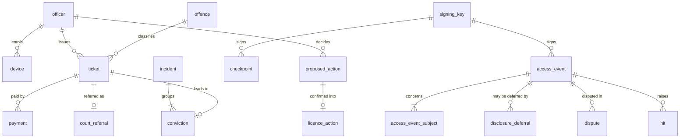

# 03 — Data model

`db/schema.sql` is canonical (PostgreSQL 16; verified to load cleanly, with the append-only and
human-decision triggers tested on 2 Nov 2026). This document explains it. TRUSTLINE stores **no
agency master records**: no licence register, vehicle register, criminal, court or health
records. It stores only what it creates.

## What TRUSTLINE owns

| Schema | Table | Holds | Personal identifiers |
| --- | --- | --- | --- |
| core | `agency` | Participating agencies | — |
| core | `officer` | Officers, badge, unit, roles | Officer's own NIC key (for self/colleague-lookup rules) |
| core | `device` | Enrolled devices, public key, attestation | — |
| core | `service_principal` | System callers (court) | — |
| core | `reason_code` | Purposes loaded from rules/reason-codes.yaml | — |
| core | `hit` | Warrant / stolen matches and dispatcher decisions | Subject key |
| core | `offline_bundle` | Issued bundles (metadata and digest only) | — |
| ledger | `access_event` | One append-only entry per ledger-scoped request | None (keys are in the next table) |
| ledger | `access_event_subject` | Subject keys attached to each entry, with relation | Subject keys |
| ledger | `checkpoint` | Signed Merkle roots over entry ranges | — |
| ledger | `signing_key` | Public keys and status | — |
| ledger | `disclosure_deferral` | Time-limited, approved deferrals of citizen visibility | Subject key |
| tickets | `offence` | Offence catalogue from rules/offences.yaml | — |
| tickets | `ticket` | Tickets issued | Subject key; identifiers envelope-encrypted |
| tickets | `payment` | Payments (simulated in this build) | — |
| tickets | `court_referral` | Court case references, hearings, outcomes, appeals | — |
| tickets | `court_fine` | Fines imposed on conviction (section 107) | Subject key |
| demerit | `incident` | Groups offences from one occurrence | Subject key |
| demerit | `conviction` | Points recorded on conviction | Subject key |
| demerit | `proposed_action` | Section 179 / 107 proposals awaiting a decision | Subject key |
| demerit | `licence_action` | Confirmed suspensions and disqualifications | Subject key |
| citizen | `dispute` | Citizen disputes of access entries or tickets | Subject key |
| oversight | `alert` | Anomaly alerts and reviews | Subject key |
| oversight | `monthly_report` | Aggregates and checkpoint roots | None |
| ems | `emergency_card_consent` | Opt-in flag and consent version | Subject key |

A **subject key** is `HMAC-SHA-256(pepper, "NIC:" + nic)` (see docs/02 §3). It lets the citizen's
access log and the demerit ledger find a person's rows without the database ever holding the NIC.

## Relationships

## Invariants enforced in the database

| Invariant | Mechanism |
| --- | --- |
| Ledger rows are never changed or removed (HL8) | `ledger.reject_mutation()` triggers on UPDATE, DELETE and TRUNCATE; app role lacks UPDATE/DELETE |
| A licence action exists only for a proposal confirmed by the same officer (HL5) | `demerit.require_confirmed_proposal()` trigger |
| A decided proposal records who and when | CHECK on `proposed_action` |
| A deferral cannot be self-approved | CHECK `approved_by <> requested_by` |
| An active deferral has an approver | CHECK on `disclosure_deferral` |
| Hits record a decider once decided | CHECK on `core.hit` |
| Offline entries carry the device time | CHECK on `access_event` |
| Hash, signature and root sizes are exact | `octet_length` CHECKs |

## Invariants enforced in code (with tests)

- No raw identifier in `ledger.*`, logs or traces (scan test over entries and captured logs).
- Ledger `seq` is gap-free and the chain verifies (`trustline-cli ledger verify`).
- `tickets.offence.fixed_penalty_ecd` and demerit points are used only with the rules file hash
  recorded (`rules_version`); unverified rules keep the banner on (HL11).
- No table is added that mirrors an agency register (schema test lists allowed tables).

## Retention

Proposed periods are in `rules/retention.yaml` (`verified: false`). They are proposals for
counsel and the Data Protection Commissioner, not legal positions. Deletion jobs must never touch
`ledger.*`; ledger retention is handled by archiving signed exports, not deleting rows.
